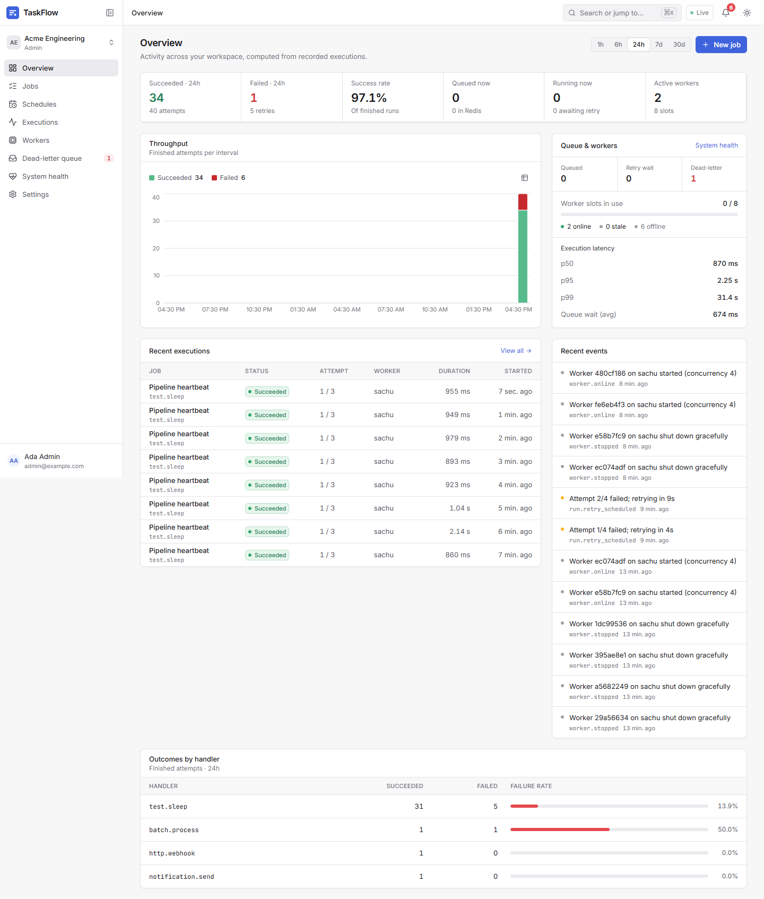
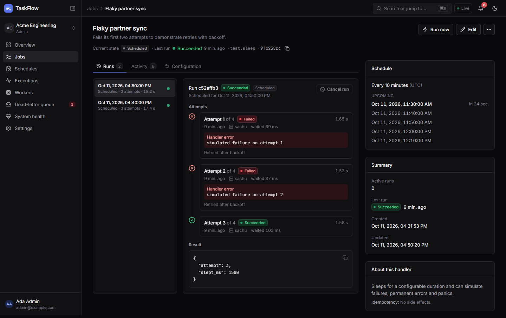
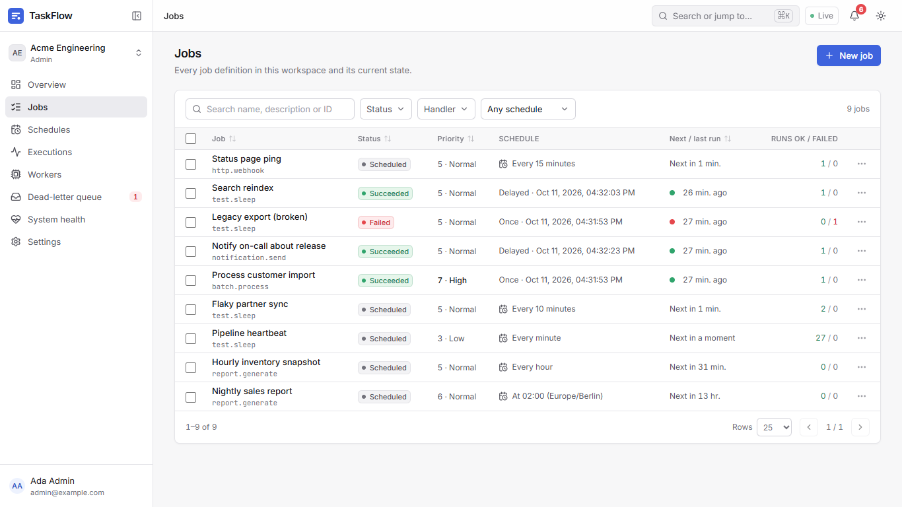
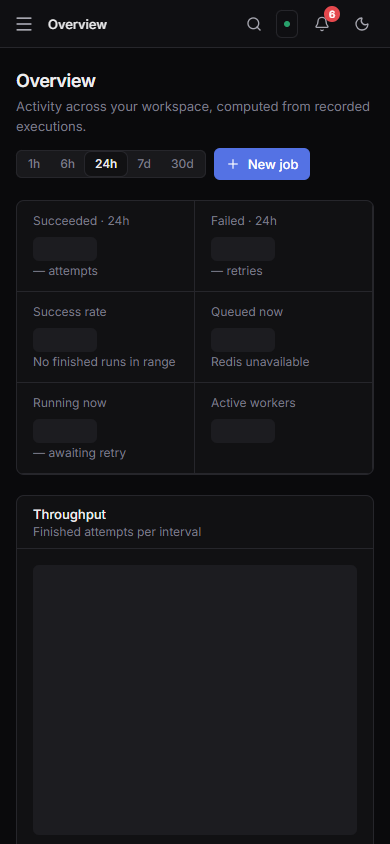
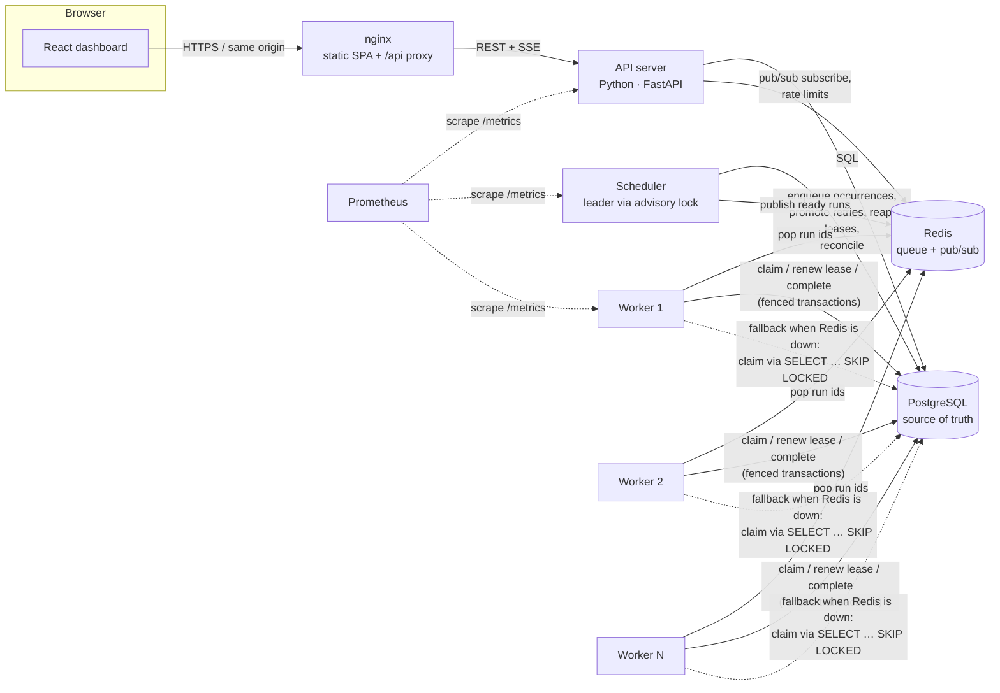
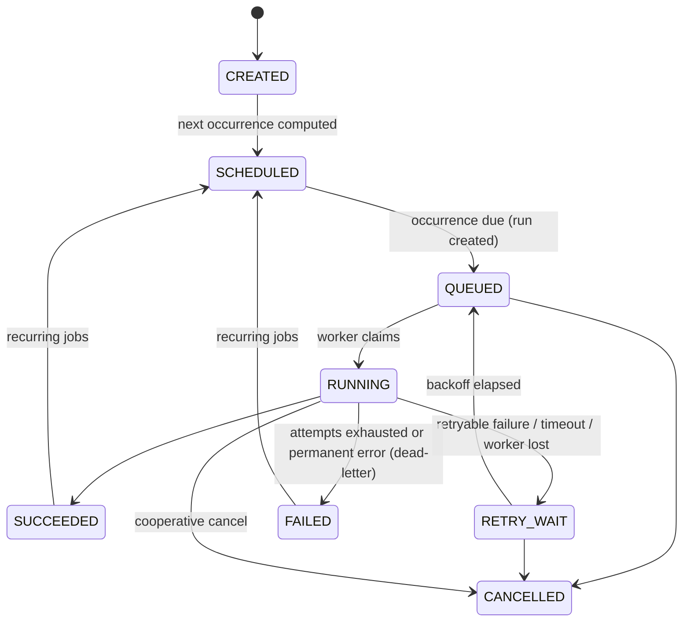
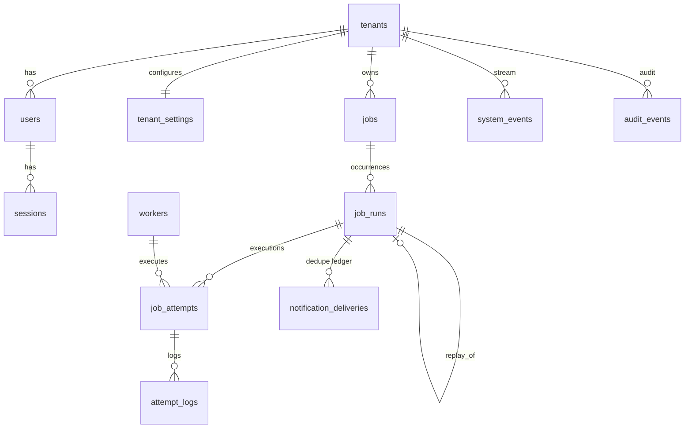

# TaskFlow — Distributed Job Scheduling and Execution Platform

TaskFlow schedules, dispatches, executes, retries and monitors background jobs across multiple worker processes. It is built to show how a job system behaves when things go wrong: workers crash mid-job, Redis disappears, schedulers restart, and operators cancel work that is already running.

**Stack:** Python 3.12 (FastAPI, asyncio, psycopg 3) · PostgreSQL · Redis · React + TypeScript + Vite + Tailwind · Docker Compose · Prometheus · Playwright · GitHub Actions



| Job details (dark) | Jobs explorer | Mobile |
|---|---|---|
|  |  |  |

---

## Contents

- [Problem](#problem) · [Features](#features) · [Architecture](#architecture) · [Job lifecycle](#job-lifecycle)
- [Delivery guarantees](#delivery-and-consistency-guarantees) · [Retries and recovery](#retries-and-recovery)
- [Database schema](#database-schema) · [Security](#security) · [API](#api)
- [Run it locally](#run-it-locally) · [Testing](#testing) · [Load testing](#load-testing)
- [Technology choices](#technology-choices-and-trade-offs) · [Known limitations](#known-limitations) · [Future work](#future-improvements)
- Deeper docs: [architecture](docs/architecture.md) · [failure scenarios](docs/failure-scenarios.md) · [API](docs/api.md) · [deployment](docs/deployment.md) · [interview guide](docs/interview-guide.md)

## Problem

Background work (reports, imports, notifications, webhooks, maintenance) has to run reliably *outside* the request path. A useful job system must answer hard questions:

- What happens when the machine running a job dies halfway?
- How do several workers share a queue without running the same job twice at the same time?
- How does a recurring schedule avoid firing twice when the scheduler restarts — or firing zero times during a daylight-saving change?
- What does "exactly once" really mean when the job calls an external API?

TaskFlow answers them with an explicit state machine, PostgreSQL as the source of truth, Redis as an accelerator, leases with fencing, and idempotency at every layer — and documents where the guarantees stop.

## Features

**Scheduling** — one-time, delayed and recurring (5-field cron or `@hourly`/`@daily`) jobs; IANA timezones with defined DST behaviour; missed-run policies (`skip`, `run_once`, `run_all` capped at 50) for downtime and pauses; overlap policies (`skip`, `queue`, `allow` with a concurrency limit); live server-side preview of upcoming runs.

**Execution** — five built-in handlers behind a plugin interface: deterministic report generation, checkpointed batch processing, idempotent notification delivery, SSRF-safe HTTP webhooks, and a configurable test job (delays, failures, panics). Per-attempt timeouts, cooperative cancellation, panic isolation, bounded worker concurrency, attempt logs.

**Reliability** — atomic claiming, leases renewed by heartbeat and fenced by attempt id, automatic recovery of runs abandoned by crashed workers, exponential backoff with jitter, dead-letter queue with audited one-time replay, graceful worker drain, scheduler leader election, Redis↔PostgreSQL reconciliation, Redis-outage fallback to PostgreSQL polling.

**Operations UI** — overview dashboard computed from stored executions (throughput, success rate, p50/p95/p99 latency, queue wait, worker capacity), jobs explorer with search/filters/sorting/pagination/bulk actions, job details with run and attempt timelines and logs, schedules, execution history, workers (heartbeats, utilisation, drain), dead-letter queue, system health, settings, members and audit log. Live updates over Server-Sent Events with polling fallback and a visible connection indicator. Light and dark themes; responsive from 375px phones to wide desktops; keyboard command palette (`Ctrl/⌘+K`).

**Security** — argon2id passwords, opaque hashed session tokens in HttpOnly cookies, per-session CSRF tokens plus Origin checks, RBAC (admin / operator / viewer), workspace (tenant) isolation, rate limiting, request size limits, strict CSP, audit logging, outbound-network guard for webhooks.

## Architecture



| Component | Responsibility |
|---|---|
| **React dashboard** | Operator UI. Reads only from the API; live-updates via SSE, polls when SSE is degraded. |
| **API server** | Auth, validation, RBAC, tenant scoping, job management, read models, SSE fan-out, OpenAPI docs, `/metrics`. Stateless; scale horizontally. |
| **PostgreSQL** | Durable state: jobs, runs, attempts, logs, workers, events, audit. Every state transition is a conditional UPDATE in a transaction. |
| **Redis** | Priority ready queue (ZSET), deferred set, lifecycle pub/sub (SSE + immediate cancellation), rate-limit counters. Losing it costs latency, not correctness. |
| **Scheduler** | Turns due occurrences into runs, promotes retries whose backoff elapsed, recovers expired leases, marks silent workers offline, re-publishes runs missing from Redis, applies retention. One leader at a time (PostgreSQL advisory lock); every loop is also safe to run concurrently. |
| **Workers** | Claim runs atomically, execute handlers with timeouts and bounded concurrency, renew leases, report outcomes, heartbeat, drain gracefully. Run as many as you like. |

The full design — data flow, locking discipline, why each piece exists — is in [docs/architecture.md](docs/architecture.md).

## Job lifecycle

A **job** is a definition (what, when, how to retry). Each occurrence of a job is a **run**; each execution of a run is an **attempt**. Runs follow a strict state machine (`backend/taskflow/statemachine.py`); a job's status is *derived* from its runs inside the same transaction.



Run transitions allowed by the table (everything else is rejected): `QUEUED→RUNNING|CANCELLED`, `RUNNING→SUCCEEDED|RETRY_WAIT|FAILED|CANCELLED`, `RETRY_WAIT→QUEUED|CANCELLED`. `PAUSED` is an operator overlay on the job: no new occurrences are scheduled and queued runs are held; running attempts finish.

## Delivery and consistency guarantees

**TaskFlow provides at-least-once execution, not exactly-once.** Distributed locks alone cannot give exactly-once execution: a worker can finish the work and then crash (or lose its network) before recording the result, so the work runs again. Instead TaskFlow guarantees:

| Guarantee | How |
|---|---|
| A run is **claimed by at most one worker at a time** | Claim = job row lock + conditional `UPDATE … WHERE status='QUEUED'` in one transaction. Tested with 10 concurrent claimers. |
| A worker that **lost its lease cannot overwrite** a newer attempt | Every renew/checkpoint/complete is conditioned on `current_attempt_id` (a fencing token). |
| A scheduled occurrence is **enqueued at most once** | Unique index on `(job_id, scheduled_for)`; concurrent schedulers + restarts tested. |
| Concurrency limits are **never exceeded** | Per-job limit checked under the job lock; workspace limit under a per-tenant advisory lock. |
| **Nothing is lost when Redis is lost** | Runs live in PostgreSQL; the reconciler re-publishes; workers fall back to polling PostgreSQL. |
| Concurrent **cancel / complete / replay** stay consistent | Fixed lock order (job → run) and conditional transitions; each failed run replayable once (unique index). |

Because a run may execute more than once, handlers must be idempotent. Every attempt of a run receives the same **idempotency key** (the run id): the webhook handler sends it as an `Idempotency-Key` header, the notification handler deduplicates deliveries in a ledger keyed by it, the batch handler checkpoints progress, and the report handler is deterministic. Job *creation* is idempotent too, via the `Idempotency-Key` request header.

The precise failure windows (e.g. "work done, result not yet recorded") are listed in [docs/failure-scenarios.md](docs/failure-scenarios.md).

## Retries and recovery

- **Backoff:** delay after failed attempt *n* = `min(max, base·2ⁿ⁻¹)`, with *equal jitter* (half fixed, half random) so mass failures don't retry in lockstep while a minimum backoff is still guaranteed.
- **Permanent errors** (invalid payload, HTTP 4xx except 408/425/429, blocked destination) skip retries and dead-letter immediately.
- **Timeouts** cancel the handler's task; the attempt is recorded `TIMED_OUT` and retried.
- **Worker crash:** leases (default 30s) are renewed every 10s. If a worker stops renewing, the scheduler marks the attempt `LOST` and retries or dead-letters the run. Reproduce it: `scripts/failure-drills.sh crash`.
- **Graceful shutdown:** on SIGTERM a worker stops claiming, reports `DRAINING`, lets attempts finish for `SHUTDOWN_GRACE`, then interrupts the rest (retried promptly elsewhere) and reports `OFFLINE`. Operators can also drain a worker from the UI.
- **Dead-letter queue:** failed runs can be inspected (failure reason, full attempt history, payload snapshot) and replayed once, with confirmation and an audit record.

## Database schema



Key constraints and indexes (see `backend/taskflow/migrations/0001_init.sql`): unique `(job_id, scheduled_for)` for scheduled runs; unique `replay_of`; unique `(tenant_id, idempotency_key)` on jobs; unique `(run_id, attempt_number)`; partial indexes for due jobs, queued runs (by priority), expiring leases and due retries; tenant-scoped time indexes for history queries. All timestamps are `timestamptz` written in UTC.

## Security

- **Authentication:** argon2id (64 MiB, t=1, p=4) password hashes; constant-time verification with timing equalisation for unknown accounts; generic error messages.
- **Sessions:** 256-bit random tokens, stored only as SHA-256 hashes; `HttpOnly`, `SameSite=Lax`, `Secure` in production; sliding expiry; logout and password change revoke sessions server-side.
- **CSRF:** per-session token required on every state-changing request (synchronizer-token pattern) plus Origin/Referer verification.
- **Authorization:** roles `admin` (everything), `operator` (manage jobs/runs/DLQ), `viewer` (read-only), enforced server-side per route; every query is scoped to the caller's workspace. Workers are shared infrastructure: worker details only show the caller's workspace's runs, and draining a worker requires a *platform* admin (`PLATFORM_ADMIN_EMAILS`) — a self-registered workspace admin cannot disrupt other tenants.
- **Input handling:** strict JSON decoding (unknown fields rejected), 1 MB body limit, 64 KB payload limit, per-handler payload validation, parameterised SQL only, allow-listed sort columns, escaped LIKE patterns.
- **SSRF protection for webhooks:** scheme/credential/port checks at save time, and a dialer that re-checks the **resolved IP at connect time** (defeats DNS rebinding) against loopback, private, link-local (incl. `169.254.169.254`), CGNAT, multicast, NAT64/6to4 and other reserved ranges — on every redirect hop. Proxy environment variables are ignored for webhooks.
- **Abuse limits:** Redis-backed rate limits (login per IP and per account, registration, job creation) with an in-process fallback when Redis is down.
- **Secrets:** only from environment variables; Compose refuses to start without database/Redis passwords; demo passwords are generated or supplied at seed time, never committed.
- **Logs:** no request bodies; credential-looking values (bearer tokens, URL credentials, sensitive query parameters) are redacted from errors and attempt logs; notification recipients are masked.
- **Headers:** strict CSP (no inline scripts, no third-party origins), `X-Frame-Options: DENY`, `nosniff`, HSTS when served over HTTPS.
- **Audit log:** sign-ins (including failures), job create/update/pause/resume/cancel, run cancel/retry/replay, settings, membership and worker drains — with actor, IP and metadata.

## API

REST under `/api/v1`, documented in **OpenAPI 3** generated by FastAPI (served at `/api/openapi.json`, Swagger UI at `/api/docs`). A route-contract test fails the build if any endpoint the frontend relies on disappears. Responses use `{"data": …, "meta": {…}}`; errors use `{"error": {code, message, fields, request_id}}`. See [docs/api.md](docs/api.md) for conventions, examples and the endpoint list.

## Run it locally

Requirements: Docker with Compose v2.

```bash
git clone <this repo> taskflow && cd taskflow
cp .env.example .env
# set POSTGRES_PASSWORD and REDIS_PASSWORD in .env (e.g. openssl rand -base64 24)
docker compose up -d --build --wait     # postgres, redis, migrate, api, scheduler, 2 workers, web
docker compose run --rm seed            # optional: demo workspace, users and jobs
open http://localhost:8080
```

The seed command creates `admin@example.com`, `operator@example.com` and `viewer@example.com` with the password from `SEED_PASSWORD` (or prints a generated one). You can also register a new workspace from the sign-in page.

Common commands (`make help` lists all):

| Task | Command |
|---|---|
| Logs | `docker compose logs -f api scheduler worker` |
| Add workers | `docker compose up -d --scale worker=4` |
| Migrations | `docker compose run --rm migrate` |
| Seed demo data | `docker compose run --rm seed` |
| Metrics | `curl localhost:8081/metrics` (API; scheduler/workers expose `:9090/metrics` inside the network) |
| Stop | `docker compose down` (add `-v` to delete data) |

Running the Python services and Vite dev server directly (without Docker for the app) is described in [docs/deployment.md](docs/deployment.md#development-without-docker).

## Testing

| Layer | What | Command |
|---|---|---|
| Backend unit (pytest) | state machine (exhaustive transition table), cron/DST, DOM/DOW semantics, missed-run planning, backoff, SSRF guard (incl. DNS rebinding), handler payload validation, deterministic reports, route contract | `make test-backend` |
| Backend integration (real PostgreSQL + Redis) | concurrent claims, concurrent schedulers, fencing after lease loss, crash recovery, cooperative cancel, replay-once under concurrency, per-job and workspace concurrency limits, tenant isolation, Redis publication + reconciler after a lost entry, Redis dispatch, worker concurrency bound, graceful shutdown, timeouts, handler crashes, idempotent notifications, checkpoint resume, API auth/CSRF/Origin/RBAC/idempotency/optimistic locking/strict decoding/rate limits/static serving/SSE | `make test-deps && make test-integration` |
| Frontend unit | API client, formatting, components (permission-aware actions, timeline), login and job-form workflows (MSW) | `make test-frontend` |
| End-to-end (Playwright) | register → create job → watch it execute → logs; recurring job pause/resume/cancel; DLQ replay + audit; viewer read-only; live updates; command palette; no horizontal overflow at 375/768/1366px; mobile drawer; dialogs fit small screens | `make up seed && make e2e` |
| Failure drills | SIGKILL a busy worker; stop Redis; restart the scheduler twice | `make drills PASSWORD=<seed password>` |

CI (`.github/workflows/ci.yml`) runs linting (ruff, ESLint, Prettier, tsc), the backend pytest suite against PostgreSQL and Redis service containers, frontend tests and build, then brings up the Compose stack and runs Playwright and the failure drills against it.

## Load testing

`python -m taskflow loadtest` submits jobs through the public API, waits for completion, then computes metrics from TaskFlow's own execution records (nothing is estimated):

```bash
make loadtest PASSWORD=<seed password> JOBS=1000
# or: python -m taskflow loadtest --url http://localhost:8080 --email admin@example.com \
#        --password … --jobs 1000 --concurrency 20 --duration-ms 50 --fail-rate 0.05 [--json]
```

It reports submission rate, end-to-end throughput, queue wait (attempt start − run queued) and execution latency percentiles, retries, failure rate and worker utilisation (busy worker-seconds ÷ available worker-seconds).

**Measured results** (one laptop: Windows 11, Docker Engine in WSL2 with 12 vCPUs / ~4 GB RAM; every container on that host; load generator inside the Compose network, through nginx; `test.sleep` jobs of 50 ms, 5% simulated failure rate, 3 attempts):

| Workers × concurrency | Jobs | End-to-end throughput | Exec p50 / p95 | Retries | Failed jobs | Utilisation |
|---|---|---|---|---|---|---|
| 2 × 4 (8 slots) | 1,000 | 50.9 jobs/s | 72 / 120 ms | 60 | 0 | 59% |
| 4 × 4 (16 slots) | 2,000 | 63.7 jobs/s | 88 / 211 ms | 107 | 0 | 47% |

Queue wait is high in these runs by design: jobs are submitted faster than the slots can drain them. With 4 workers the limit is the single API process (~75 job submissions/s); run more API replicas to go further. The numbers describe this machine only; reproduce them on yours with the command above. The load test also found a real bottleneck: each worker claimed runs through one sequential loop, so claim latency (~30 ms under load) capped every worker below its slot count. Giving each slot its own claim loop — the concurrency bound is unchanged and covered by a test — raised 2-worker throughput from 31.9 to 50.9 jobs/s with identical parameters. See also [docs/failure-scenarios.md](docs/failure-scenarios.md#found-by-testing).

## Technology choices and trade-offs

- **PostgreSQL as the source of truth** — transactions, row locks, `SKIP LOCKED`, partial and unique indexes give atomic claims, idempotent scheduling and consistent state transitions in one place. Cost: every claim/complete is a transaction (~10–15 statements), so PostgreSQL write throughput bounds the system.
- **Redis as an accelerator** — a priority ZSET gives low-latency dispatch without N workers polling PostgreSQL, plus pub/sub for SSE and instant cancellation, and shared rate-limit counters. Because claims are verified in PostgreSQL, duplicate or lost Redis entries are harmless (duplicates fail to claim; lost entries are re-published). Redis Streams/consumer groups were not needed: PostgreSQL already provides the delivery state.
- **Advisory-lock leader election** — the scheduler's leadership is tied to a PostgreSQL session, so a leader that loses its database connection loses leadership automatically. Correctness never depends on a single leader.
- **Leases + fencing instead of locks held for the job's duration** — a dead worker's lease simply expires; a slow-but-alive worker is fenced out by attempt id.
- **One Python package, one image** for api/scheduler/worker/migrate/seed/loadtest (`python -m taskflow <command>`) — consistent code paths everywhere. Everything is `asyncio`: one process handles hundreds of concurrent requests, attempts, lease renewals and heartbeats without threads; CPU-bound password hashing runs in a bounded thread pool.
- **Python over a compiled language** — readability and a smaller codebase, at the cost of per-process CPU throughput (the GIL keeps one process on one core). The design scales by adding processes (API replicas, workers), which the architecture already supports; PostgreSQL remains the real ceiling.
- **No Kafka, Kubernetes or etcd** — none would add a guarantee this design lacks at this scale; Compose keeps the system runnable on a laptop.
- **React Query + SSE** — events carry only ids; clients re-fetch through the normal authorised API, so the stream can never leak data and missed events self-heal.

## Known limitations

- **At-least-once:** an attempt whose worker dies after the work but before recording the result will run again. External side effects need receiver-side idempotency (TaskFlow sends `Idempotency-Key`).
- **Single PostgreSQL primary** is a single point of failure and the throughput ceiling; no read replicas or partitioning yet. Attempt logs and events are pruned by retention but runs/attempts are kept indefinitely.
- **Leases use application clocks.** Workers and the scheduler compare timestamps produced on different hosts; large clock skew could expire a lease early. Run NTP; the 30 s lease tolerates typical skew. Using database time for lease arithmetic is a listed improvement.
- **Recovery latency** after a crash is up to the lease duration plus the reaper interval (~32 s by default).
- **One global ready queue:** workers restricted to a subset of handlers (`WORKER_HANDLERS`) re-defer runs they cannot execute; per-handler queues would avoid that churn.
- **Pub/sub is fire-and-forget:** a dropped SSE event delays a UI refresh until the next event or poll; it never affects execution.
- **Payload secrets** (e.g. webhook `Authorization` headers) are stored in PostgreSQL unencrypted; they are tenant-scoped and redacted from logs, but not encrypted at rest by TaskFlow.
- **Account enumeration:** registration and member creation report "email already exists" (login does not leak it); mitigated by rate limits.
- **Platform vs. workspace data:** any signed-in user can see platform-level worker metadata (hostnames, PIDs, handlers) and aggregate queue health; job data is always tenant-scoped.
- **Workspaces:** each user belongs to one workspace; admins add members with an initial password (no email invitations). The sidebar shows the workspace rather than offering a switcher.
- **DST:** fixed-time schedules run once per wall-clock time (a skipped 02:30 runs at 03:30; a repeated 01:30 runs once); hourly schedules follow real time. Documented, tested, but a deliberate choice.
- Verified locally with Docker Engine on WSL2; the CI workflow's steps were executed locally but the workflow has not yet run on GitHub.

## Future improvements

- Database-clock leases (`now()` in SQL) to remove clock-skew sensitivity.
- Per-handler queues and weighted fair scheduling across workspaces.
- Envelope encryption for sensitive payload fields; secret references instead of inline values.
- Partitioning / archival of `job_runs` and `job_attempts`; read replicas for dashboards.
- Workflow dependencies (DAGs), job chaining and fan-out/fan-in.
- OpenTelemetry tracing across API → queue → worker.
- Email invitations, SSO (OIDC) and multi-workspace membership.
- Outbox-based webhook signatures (HMAC) so receivers can authenticate TaskFlow.

## Repository layout

```
backend/
  taskflow/
    __main__.py          entry point: api | scheduler | worker | all-in-one | migrate | seed | loadtest | healthcheck
    api/                 FastAPI app, ASGI middleware, SSE hub, static SPA serving, error envelopes
    services/            business logic (jobs, auth, ops/read models)
    engine.py            every lifecycle operation (schedule, claim, complete, recover, cancel, replay)
    statemachine.py      transition table, job-status derivation, action rules
    store/               PostgreSQL repositories (parameterised SQL, psycopg 3)
    cron.py              cron + timezone/DST evaluation, missed-run planning
    retry.py             backoff with jitter
    queue.py             Redis queue, deferred set, pub/sub
    scheduler.py         leader election and control loops
    worker.py            execution runtime (slots, leases, cancellation, drain)
    handlers/            job-handler interface + built-in handlers
    netguard.py          SSRF-safe outbound connections
    migrations/          SQL schema
    auth.py config.py db.py logs.py metrics.py ratelimit.py seed.py loadtest.py
  tests/                 pytest: unit + integration (real PostgreSQL and Redis)
frontend/
  src/components/ui/     design-system primitives      src/pages/   one folder per page
  src/api/  src/app/     data hooks, session/theme/live providers
  e2e/                   Playwright specs (+ visual audit script)
scripts/failure-drills.sh   reproducible failure scenarios
docs/                    architecture, failure scenarios, API, deployment, interview guide
```
