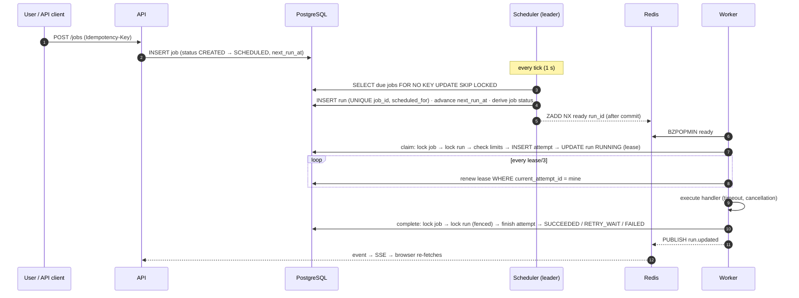

# Architecture

This document explains how TaskFlow is put together and why. It assumes you have read the README's overview.

## Design principles

1. **PostgreSQL is the only source of truth.** Every fact that matters — what is due, who is running what, what succeeded — is a row changed inside a transaction. Redis holds hints that can be rebuilt.
2. **Every state change goes through one place.** `internal/engine` implements all lifecycle operations; `internal/statemachine` decides which transitions are legal. No other code writes a status.
3. **Assume crashes everywhere.** Any process can die between any two lines. Each operation is either a single transaction or safe to repeat, and side effects outside PostgreSQL happen after commit and are reconciled.
4. **At-least-once, made safe by idempotency.** Exactly-once execution is impossible across a network boundary; duplicates are prevented where they can be (claims, occurrences, replays) and made harmless where they cannot (handlers).

## Components and data flow



### API server (`internal/api`, `internal/service`)

Stateless HTTP server on Go's `net/http` mux. Middleware order: request id / panic recovery / access log / metrics / security headers → CORS → Origin check → session authentication → per-route auth, CSRF, role and rate-limit wrappers. Handlers decode strictly, call a service and map domain errors to HTTP (`422` validation with per-field messages, `409` conflicts with a reason, `404` for anything outside the caller's workspace).

The SSE hub keeps **one** Redis subscription per API process and fans events out to connected browsers, filtered by workspace. Events contain identifiers only; the browser invalidates the matching React Query caches and re-fetches through authorised endpoints. If Redis is unreachable the hub tells clients (`event: status {"live":false}`) and the UI switches to 5-second polling.

### Engine (`internal/engine`)

All writes to jobs and runs:

| Operation | Called by | Essence |
|---|---|---|
| `ScheduleDue` | scheduler | lock due jobs, plan occurrences (missed-run + overlap policy), insert runs idempotently, advance `next_run_at`, derive status |
| `PromoteRetries` | scheduler | `RETRY_WAIT → QUEUED` for runs whose backoff elapsed |
| `RecoverExpiredLeases` | scheduler | attempt `LOST`; run → `RETRY_WAIT` / `FAILED` / `CANCELLED` |
| `Reconcile` | scheduler | re-publish QUEUED runs missing from Redis (`ZADD NX`) |
| `Claim` / `ClaimNext` | workers | atomic `QUEUED → RUNNING` with concurrency limits; `ClaimNext` is the Redis-free path |
| `RenewLease`, `SaveCheckpoint` | workers | fenced by `current_attempt_id` |
| `Complete` | workers | fenced; decides success / retry with backoff / dead-letter / cancelled |
| `CancelJob`, `CancelRun`, `PauseJob`, `ResumeJob`, `RetryJob`, `ReplayRun`, `RunNow` | API | validated by `statemachine.JobActions`, audited in the same transaction |

Each operation collects post-commit *effects* (publish run ids, publish events, send cancel signals) and flushes them after the transaction commits. If flushing fails, nothing is lost: the reconciler and the workers' PostgreSQL fallback cover it.

### Locking discipline

- **Lock order is always job row → run rows.** The scheduler, workers and API actions all follow it, so they cannot deadlock each other. (An early version promoted retries by locking runs first; it was rewritten to respect the order.)
- Job rows are locked with `FOR NO KEY UPDATE`, which does not conflict with the `KEY SHARE` locks taken by foreign-key checks when runs are inserted.
- Schedulers use `SKIP LOCKED` on due jobs so several instances (or a scheduler racing an edit) never block each other.
- Claims take a *blocking* lock on the run row after the job lock. `SKIP LOCKED` there was a bug: an unrelated short-lived lock (the post-publish `MarkPublished` update) made a claimable run look stale.
- Workspace concurrency limits use a transaction-scoped advisory lock per tenant, taken only when a limit is configured.

### Scheduler (`internal/scheduler`)

One process may run several replicas. Leadership is `pg_try_advisory_lock` held on a dedicated pooled connection; it is verified every tick with a ping, and released explicitly on shutdown or implicitly when the session dies. Leader loops:

| Loop | Interval |
|---|---|
| enqueue due occurrences (batches of 200, up to 20 batches/tick) | every tick (1 s) |
| promote due retries; promote Redis-deferred runs | every tick |
| recover expired leases | 2 s |
| mark silent workers offline | 5 s |
| reconcile Redis with PostgreSQL | 10 s |
| queue-depth gauges | 5 s |
| retention (events, sessions, old worker rows) | hourly |

None of these depend on mutual exclusion for correctness — leadership only avoids duplicate work.

### Workers (`internal/worker`)

A worker registers itself, heartbeats every 5 s (status, active runs, heap and goroutine counts), and runs a claim loop bounded by a semaphore of size `WORKER_CONCURRENCY`:

1. Pop the best run id from Redis (`BZPOPMIN`, 1 s). On a Redis error, switch to `ClaimNext` against PostgreSQL and probe Redis every 5 s.
2. Claim it. `ErrStale` (claimed elsewhere / duplicate entry) → drop; `ErrDeferred` (concurrency limit) or unsupported handler → park in the delayed set for 1–2 s; `ErrPaused` → drop (resume re-publishes).
3. Execute in a goroutine with a context that carries a *cause*: operator cancel, timeout, shutdown or lease loss. A companion goroutine renews the lease every `lease/3`, flushes attempt logs every second and turns a cancellation flag into context cancellation. A Redis pub/sub listener makes cancellation near-instant; lease renewal is the guaranteed path.
4. Classify the result from the error and the context cause, and `Complete` with retries for up to one lease duration on database errors.

Panics in handlers are recovered and recorded with a stack excerpt; the worker keeps serving other runs.

### Handlers (`internal/handlers`)

```go
type Handler interface {
    Name() string
    Info() Info                                   // title, description, fields, example payload, idempotency notes
    Validate(payload json.RawMessage) error       // used by the API on create/update and by the worker before running
    Execute(ctx context.Context, x *Execution) (json.RawMessage, error)
}
```

`Execution` provides the run/attempt ids, attempt number, payload, saved checkpoint, a stable `IdempotencyKey`, a redacting logger and `SaveCheckpoint`. Returning `handlers.Permanent(err)` skips retries. Adding a job type means implementing this interface and registering it in `handlers.Builtin`.

| Handler | Idempotency strategy |
|---|---|
| `report.generate` | deterministic output from the payload; identical retries |
| `batch.process` | checkpoint after each chunk; per-record computation is pure, so redoing a partial chunk yields the same result |
| `notification.send` | ledger table with `UNIQUE(run_id, channel, recipient)`; retries skip recipients already notified |
| `http.webhook` | sends `Idempotency-Key: <run id>`; receivers deduplicate |
| `test.sleep` | no side effects |

## Scheduling semantics

- **Evaluation:** cron fields are evaluated in the job's IANA timezone; all stored times are UTC.
- **DST** (`internal/schedule`): fixed-hour expressions use wall-clock semantics — a time skipped by spring-forward runs at the equivalent instant after the jump; a time repeated by fall-back runs once. Expressions that fire every hour follow real elapsed time (they run during both passes of a repeated hour). This matches Vixie cron/cronie and is covered by tests for America/New_York transitions.
- **Missed runs:** occurrences more than 60 s late are "missed". `skip` drops them, `run_once` coalesces all due occurrences into one run, `run_all` runs each (capped at 50, newest kept). Pausing a job and resuming later is handled by the same policy.
- **Overlap:** `skip` drops an occurrence while a run is active (and records an event), `queue` enqueues it but limits the job to one running attempt, `allow` runs up to `max_concurrency` at once.
- **One-time jobs** run late rather than being skipped.
- **Configuration snapshot:** a run copies the job's handler, payload and retry policy when created, so edits never change in-flight work.

## Data model notes

- `jobs.status` is derived, never written ad hoc: `CANCELLED`/`PAUSED` (operator overlays) take precedence, then the most advanced in-flight run (`RUNNING > QUEUED > RETRY_WAIT`), then `SCHEDULED` if another occurrence exists, else the last terminal outcome.
- `jobs.version` implements optimistic concurrency for edits (`If-Match`).
- `job_runs.published_at` lets the reconciler find runs whose publication failed after commit.
- `system_events` is the operational timeline (pruned by retention); `audit_events` records human actions and is never pruned automatically.

## Observability

- **Logs:** JSON (`log/slog`) with component, request id, user id, route, status and duration; worker logs carry run id, attempt and handler.
- **Metrics** (Prometheus): HTTP rate/latency by route pattern; runs enqueued by trigger; occurrences skipped by reason; attempts finished by handler/status; attempt duration and queue wait histograms; claim outcomes by source (redis/db); leases recovered; results discarded after lease loss; reconciler re-publishes; Redis errors by operation; worker active runs/capacity; queue depth by source; scheduler tick duration and leadership; SSE clients.
- **Health:** `/healthz` (liveness) and `/readyz` (PostgreSQL reachable) on every process; the API's `/api/v1/system/health` aggregates dependencies, scheduler leadership, worker availability, queue depth and error/retry rates for the UI.

## Frontend architecture

- **Data:** React Query hooks in `src/api/hooks.ts` wrap a typed fetch client (`src/lib/api.ts`) that attaches the CSRF token, unwraps envelopes and raises `ApiError` with field errors and request ids. Components never call `fetch` directly.
- **Live updates:** `LiveProvider` owns the EventSource, coalesces bursts of events into one invalidation, and exposes the connection state used by the top-bar indicator and by `usePollInterval` (polling only when not live).
- **Design system:** tokens as CSS variables (light/dark), Tailwind mapped to semantic names, primitives in `src/components/ui` (buttons with disabled-reason tooltips, fields with inline errors, status badges, tables, dialogs, sheets, dropdowns, tabs, skeletons, empty/error states, metric strips). Chart colours were validated for colour-vision deficiencies and every chart has a legend and a table view.
- **Permissions:** server-provided `actions` (allowed + reason) drive every job action; role checks only add a "read-only" explanation for viewers.
